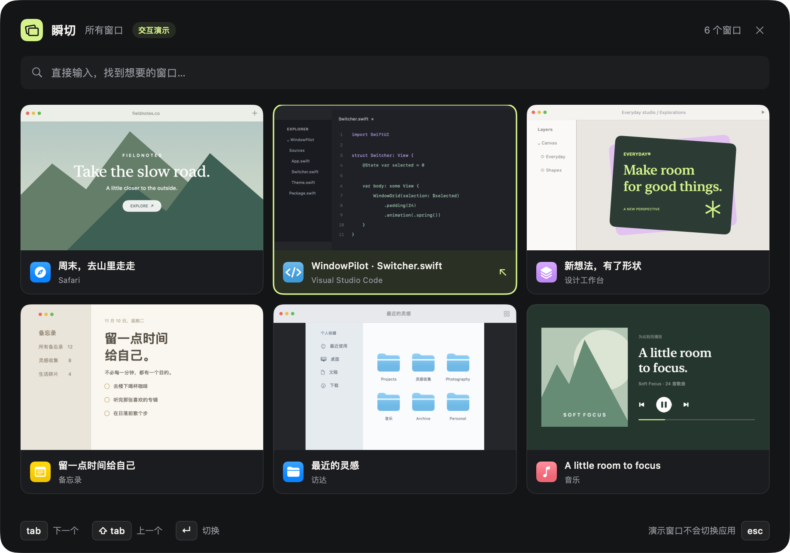
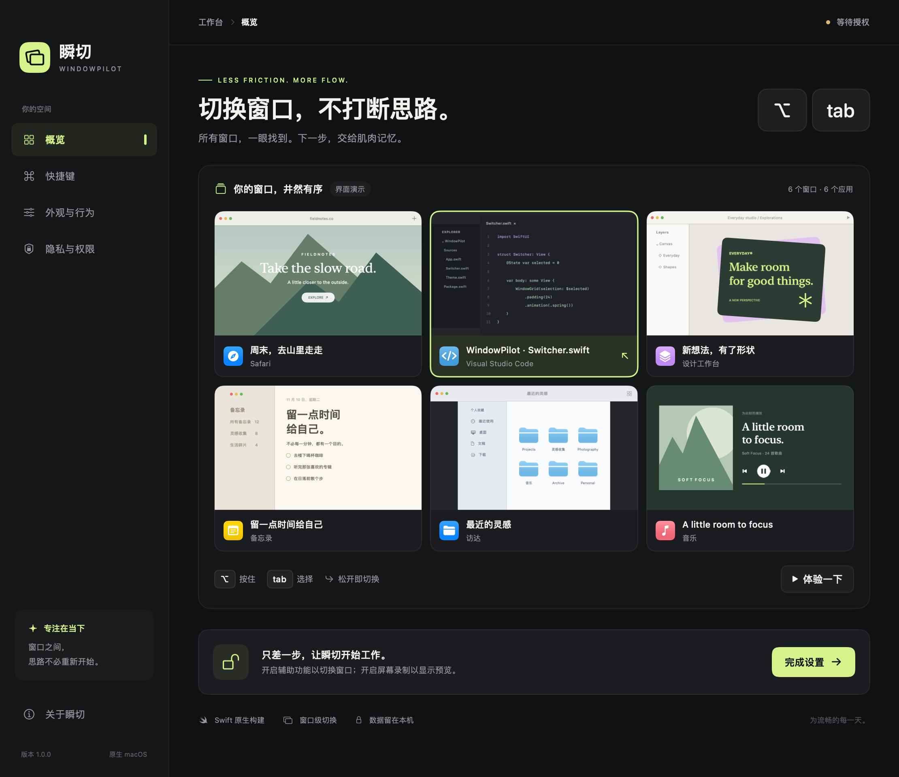

# 瞬切 WindowPilot

一个原生 macOS 窗口切换工具，借鉴 AltTab 的交互，使用 Swift、AppKit、SwiftUI 独立实现。没有第三方依赖、网络请求或账户系统。



[下载 macOS Apple Silicon 预览版](https://github.com/xikee/WindowPilot/releases/tag/v1.0.0-preview.3) · [测试记录](docs/VALIDATION.md)

## 打开应用

从 Release 下载 ZIP，解压得到 `瞬切.app`。本地构建产物位于 `dist/瞬切.app`。应用常驻菜单栏，关闭设置窗口后仍然运行；从菜单栏选择「退出瞬切」结束。

当前发布为 `v1.0.0-preview.3`（构建 6），要求 macOS 13+、Apple Silicon。本预览版使用本地临时签名，没有开发者公证；下载后如被 macOS 阻止，可能需要在系统「隐私与安全性」中允许打开。

第三个预览版缩短了面板出现前的等待，修复了刚打开窗口时首次切换，以及按住 Option 连点 Tab 时高亮落后一格的问题。已在 macOS 14.8.9 实测「所有窗口」和「当前应用」两种快捷键，松开 Option 后会置前最后高亮的窗口。

第一次使用时，在「隐私与权限」中：

1. 点击「打开系统设置」，在「隐私与安全性 → 辅助功能」中添加并启用 `瞬切.app`。这是枚举窗口、监听快捷键和切换窗口所必需的。
2. 如果需要缩略图，点击「开启窗口预览」，授予屏幕录制权限。这项权限可选；未授权时仍可通过图标和标题切换。
3. 如果 macOS 要求重新启动应用，从菜单栏退出后再打开。

可以先点击「体验一下」，无须任何系统权限。演示数据有明确标注，不会激活其他应用。

建议把应用放到固定路径后再授权。重新编译会改变临时签名；即使旧开关显示开启，新构建仍可能未获授权。请在系统设置中移除「瞬切」的旧记录，再添加当前应用，并按系统提示重新打开；辅助功能和屏幕录制均可能需要此操作。



## 操作

| 操作 | 默认快捷键 |
| --- | --- |
| 打开切换器 / 选择下一个窗口 | `⌥ Tab` |
| 选择上一个窗口 | `⌥ ⇧ Tab` |
| 仅切换当前应用的窗口 | `⌥` + 反引号键 |
| 确认选择 | 松开 `⌥` 或按回车 |
| 取消切换 | `Esc` 或点击面板外部 |
| 按应用名、窗口标题搜索 | 切换器内直接输入 |
| 删除搜索文字 | 退格键 |
| 按窗口 / 按行选择 | 左右 / 上下方向键 |
| 在设置窗口中退出应用 | `⌘ Q` |

支持鼠标点击、最近使用排序、恢复最小化窗口、显示隐藏应用窗口、多显示器定位、仅当前显示器筛选，以及无预览的紧凑布局。主修饰键可改为 Control 或 Command；选择 Command 会接管 `⌘ Tab`。

窗口列表在后台更新；唤出时直接读取最近的窗口数据。切换到选中的窗口不必等后台刷新完成。缩略图在面板打开后按卡片请求，并分批更新；紧凑模式不截图。预览仅保存在内存中，面板关闭后清空。macOS 14+ 使用 ScreenCaptureKit，macOS 13 使用 Core Graphics 兼容实现。

## 构建与验证

需要 macOS 13+ 与 Apple Command Line Tools，或完整 Xcode。不需要 Homebrew、Node.js 或下载依赖。

```bash
bash "scripts/build.sh"
open "dist/瞬切.app"
```

脚本生成当前处理器架构的优化构建，创建应用图标并执行本地临时签名。本次交付为 Apple Silicon arm64 版本。需要调试构建时运行 `bash "scripts/build.sh" debug`。

```bash
# 不依赖 XCTest，Command Line Tools 环境也可执行。
bash "scripts/test.sh"

# 渲染五个设置页面，验证本地快捷键、搜索、取消与紧凑布局。
# 不请求辅助功能或屏幕录制权限，也不截取其他应用的画面。
"dist/瞬切.app/Contents/MacOS/WindowPilot" --verify-ui ".build/ui-verification"

# 检查打包与签名。
codesign --verify --strict --verbose=2 "dist/瞬切.app"
plutil -lint "dist/瞬切.app/Contents/Info.plist"
```

具备完整 Xcode 的环境也可以使用 `swift build`、`swift test`，或打开 `Package.swift`。本机只有 Command Line Tools，SwiftPM 无法解析 SDK 的平台路径，因此提供直接调用 `swiftc` 的等价构建与测试脚本。

核心检查覆盖快速松键、加载期间连续按键、异步返回时取消、正反向循环、空列表、单窗口、搜索恢复、中英文与重音搜索，以及 2,430 组循环索引组合。界面检查使用真实 AppKit 窗口和本地 `NSEvent`，不替代授权后的跨应用端到端测试。

另外已完成授权后的真实系统验证，记录见 [VALIDATION.md](docs/VALIDATION.md)。需要排查问题时，可先退出当前实例，再显式开启本机诊断：

```bash
WINDOWPILOT_LOG="$(pwd)/.build/live-check.jsonl"
open "dist/瞬切.app" --args --diagnostics "$WINDOWPILOT_LOG"
```

诊断默认关闭，仅记录事件名称、窗口数量、进程与窗口编号、预览尺寸和成功状态；不记录窗口标题、截图内容或输入的文字。退出后正常打开即可关闭诊断模式。

## 结构

- `Sources/SwitchCore`：纯选择状态与搜索，不依赖 AppKit。
- `WindowService.swift`：公开辅助功能 API、窗口匹配、焦点观察与缩略图。
- `HotkeyMonitor.swift`：全局事件过滤与本地演示事件处理。
- `SwitcherController.swift`：异步窗口列表与选择状态协调、面板生命周期。
- `SettingsView.swift` / `SwitcherView.swift`：设置与切换器视图。
- `Tests/SwitchCoreTests`：两个测试入口共用同一组测试场景，避免重复维护。

选择状态、系统交互与界面各自负责一件事；核心逻辑使用小型值类型，未引入额外架构框架或依赖，遵循 KISS、DRY、YAGNI 与单一职责原则。

## 当前边界

- 使用系统公开 API。其他 Space 和全屏应用窗口是否可枚举取决于 macOS 与目标应用的辅助功能实现，不保证完整跨 Space 支持。
- 不提供浏览器标签页、窗口平铺、关闭应用、自动更新或登录自启。
- 受保护内容、部分最小化窗口或特殊应用可能没有可用截图；会显示应用图标与标题。
- 不同应用对辅助功能的支持程度不同。当前已验证本机上的跨应用激活、最小化与隐藏应用恢复；多显示器、其他 Space 和其他 macOS 版本尚未专项验证。
- 已安装的其他窗口切换工具可能占用相同快捷键，可暂停其中一个或更换瞬切的主修饰键。

交互参考：[AltTab](https://alt-tab.app/)。没有复制其源码或资源。
